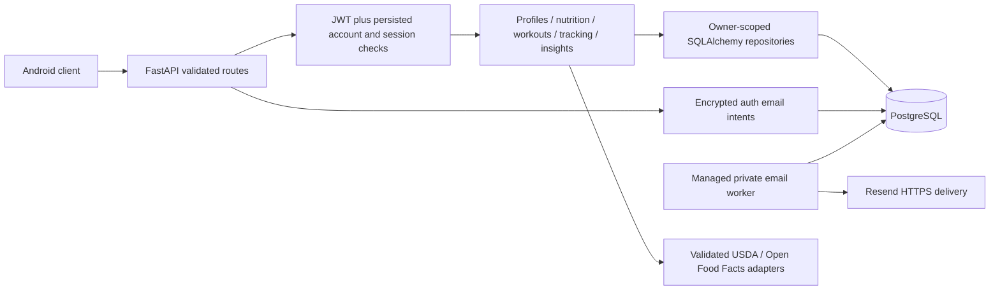

# Final MVP backend architecture

Phase 4, 28 October 2026. The final verification report identifies the frozen source
and results. This describes local source; it does not describe a verified deployment.
The application database remains at `0004` until a separately approved migration.

## Structure and trust boundaries

PROVIA remains a synchronous FastAPI modular monolith with SQLAlchemy repositories
and PostgreSQL. `app/application.py` creates the app and owns the managed email-worker
lifespan. Routes validate input, services enforce business rules, repositories scope
queries and flush changes. `app/db/dependencies.py` commits the request transaction
before sending success; errors roll back and connections close. Database errors
produce sanitized 503; integrity conflicts produce 409. Provider JSON, mobile input
and opaque external record identifiers are untrusted.

Identity is the existing internal user UUID. JWT signature/issuer/audience/expiry
checks precede persisted account/session validation. Disabled accounts and revoked
or expired sessions cannot access fitness records. Unverified sessions can inspect
`/auth/me` and `/onboarding`; verified authentication is required for business routes.
Legacy Clerk subjects and fitness UUID relationships remain; an email match never
grants ownership or enrolls an old account. `/me` contact email is separate from
the authentication email. No new legacy enrollment mechanism is introduced.

## Database and concurrency

Migrations `0001`–`0006` retain their order and contents. Additive `0007` introduces
one request-receipt table and weight source/external-ID columns and constraints.
Existing weights receive `source=manual`, `external_id=null`; existing user, food,
meal, goal, session and tracking records remain. There is no startup migration.
The receipt primary key is `(user_id, operation, key)`; resources deliberately have
no FK from receipts so a deleted record cannot be recreated by the old retry key.
Weight import identity is unique per `(user_id, source, external_id)`.

`Idempotency-Key` is an optional UUID on twelve documented create/duplicate/apply
operations. With a key, the request locks the owning user before receipt lookup and
resource creation. Both commit atomically. Only a SHA-256 fingerprint and resource ID
are stored, never the request body. The same key/body returns the current owned
resource; changed input or a deleted original returns 409. Without a key, existing
creation semantics apply. Timestamp defaults omitted by the client are excluded
from the fingerprint. Keys have no automatic TTL: pruning them would permit old
offline requests to recreate deleted resources. They cascade only with the owner.
They are application retry protection, not a guarantee of exactly-once network delivery.

Existing user locks serialize goal changes, active-plan/schedule edits, sleep overlap
checks and activity reconciliation. New workout starts also lock the user and reject
another active session; old multiple-active rows are retained and can be resolved
through status-filtered history and cancellation. Session row locks protect set
mutation/completion. Duration-only workouts remain valid with positive elapsed time;
every stored set must be completed or skipped. Completed/cancelled sessions are immutable.

## Historical data and calculations

Maintenance remains weight ×24. Daily calories subtract the selected deficit;
protein uses target weight ×1.9, fat current weight ×0.7, fiber daily calories/1000×14,
and carbohydrates are the remaining macro calories divided by four. Decimal validation,
configured minimum energy and impossible-configuration rejection remain authoritative.
Goal nutrition inputs and step/type changes create revisions; status-only changes
retain the established transition policy. Measurements never silently apply a goal.
Applying a weight requires both the expected goal ID and previewed weight value;
the service locks the measurement and rejects stale confirmation with 409.

Meals preserve quantity-scaled nutrient snapshots rounded to 0.001 with HALF_UP.
Recipe ingredients/yield preserve their own snapshots. Catalog changes do not rewrite
logged nutrients. Explicitly replacing meal items is an intentional recalculation;
notes/time-only corrections preserve snapshots. Unknown nutrients remain null, not
zero. An unlogged daily total may be zero while adherence remains unknown.

Day boundaries use the current profile IANA timezone, or UTC without a profile.
Inclusive calendar ranges become half-open UTC intervals, including 23/25-hour DST
days. Sleep belongs to local wake-up date; workouts to local start date. Goal targets
use the last transition strictly before local day-end; the last same-day transition
wins for that whole day. Changing a profile timezone reinterprets historical local
grouping. There is no invented historical zone or measurement.

## Synchronization and aggregation

Activity is a complete per-local-day replacement, never a delta. Imported snapshots
supersede manual rows; stale or same-time/different-content writes conflict. Unknown
permission/read failures must not be uploaded as zero. Weight and sleep imports use
stable, user/source-scoped external IDs; exact POST replay returns the same record,
changed data requires an owned PATCH. Source identities cannot be changed by PATCH.
Deletion and conflicting offline edits require a serialized authoritative client;
the backend is not a multi-device merge engine and has no import deletion tombstones.
The Health Connect handoff specifies these boundaries; native integration is pending.

Insights reuses the nutrition and tracking services. Queries are batched rather than
issued per calendar day, with a 366-day range limit and 10,000-row analytics bound.
Daily nutrition responses fetch at most 101 meals and reject more than 100 explicitly;
they never publish truncated totals. Each API meal has at most 100 items. Large daily
histories remain available through pagination. Unified dashboard goal context and
nutrition budgets use the same historical goal resolution under concurrent edits.
Pagination is deterministic by timestamp/name and UUID as documented per collection.
Workout personal records are observed range maxima; no estimated history or 1RM.
Activity calories never increase the nutrition budget. Query-count regressions verify
range-size independence; they do not establish production throughput or latency SLAs.

## Auth outbox and operations

Phase 3 authenticated encryption, generic public acceptance, deferred account lookup,
Argon2id hashes, token digests, bounded retries, fencing and restart recovery remain.
The worker commits preparation before provider I/O, scrubs terminal ciphertext and
expires delayed jobs safely. Resend's stable job idempotency key protects provider
retries; provider acceptance is not inbox receipt. Request intake and worker remain
disabled in the prepared Render blueprint. Never rotate the JWT signer with active
pending registration jobs: pause intake and drain first, following the Phase 3 runbook.

For Phase 4 deployment, that runbook's `0006` target is historical: after its separately
approved backup/restore and `0004→0005→0006` steps, explicitly approve and apply `0007`,
verify `alembic current` and `alembic check`, then run the updated read-only readiness
check. Do not deploy new models against `0006`. Do not downgrade populated receipt or
provenance data; use a reviewed forward repair. No live step was executed in Phase 4.

Use `python -m uv run --no-sync` for Python, tests, Ruff and Alembic in the existing
Python 3.12.15 / SQLAlchemy 2.1.6 pure-Python Windows environment. Keep the lockfile and
Windows Application Control intact. A blocked native dependency requires stopping
and authorized administrator review. No paid infrastructure, self-ping, public worker
drain, database reset or cloud APK build is part of this phase.

Render Free sleep/suspension prevents an always-on email SLA, and active polling can
consume Neon free compute. Real mail, hosted deployment, backup restore and Android
acceptance remain separate gates. See [remaining limitations](backend-remaining-limitations.md),
[frontend handoff](frontend-api-handoff.md) and [verification](backend-final-test-report.md).
