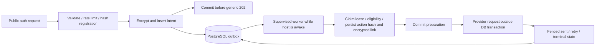

# Phase 3 — durable auth email and deployment preparation

Review and verification dates: 27–28 October 2026. Branch: `codex/first-party-auth`.
Starting commit: `0ee0d9648367b718869d551acfc596024b2cf85a`. The verified local
completion commit is identified in the completion message (`git rev-parse HEAD`).
The working tree was clean before Phase 3. No existing application migration,
deployment, publication/merge, real email, APK build, phone-data change or paid
resource creation was performed. Local verification uses `python -m uv run --no-sync`.
SQLAlchemy remains 2.1.6 with `HAS_CYEXTENSION=False`; Python remains 3.12.15.

## Security findings and fixes

The synchronous provider timing branch is removed. Every valid registration,
resend and recovery request takes a transactional encrypted-intent path regardless
of account existence. Registration hashes the submitted password for every address.
Public handlers do not query accounts or call the provider. Eligibility and new
account creation happen later in the worker. Generic 202 responses and existing
rate limits remain; validation, configuration, database and throttling failures
remain failures. The request transaction commits before the success response.

This removes the identified account-dependent provider latency, not every possible
timing signal. Load, rate-limit history and shared database contention still affect
latency. The small controlled measurements below are evidence, not proof of perfect
statistical resistance or real internet performance.

Other verified corrections:

- Registration preserves the earliest pending request's password. Later queued
  registrations cannot replace it or overwrite an existing account. Legacy email
  matches cannot claim the old UUID or its fitness data.
- Claim completion refreshes the real clock after acquiring the row lock, so an
  expired lease cannot acknowledge a send after a long lock wait. Explicit test
  clocks remain deterministic.
- Pausing intake stops new encrypted intents while a supervised worker can drain
  existing jobs for controlled key rotation. This is not a bypass of verification.
- Key rings are bounded, authenticated, job/purpose-bound and reject reuse of JWT
  signing material. Missing/invalid keys fail closed without displaying their values.
- Mobile success paths validate the `MessageOut` shape, retain error states for
  malformed responses, distinguish accepted requests from delivered mail, and allow
  recovery retry after a cooldown. Link copy reflects the remaining queue deadline.
- Supported dependency patches address node-forge and align the SDK 58 package
  matrix; unsupported major overrides and ignored Doctor checks were not used.

## Actual specialist execution

Native agents ran concurrently with non-overlapping ownership, in waves limited to
three specialists plus the coordinator. The coordinator owns integration, settings,
lifespan supervision, generated contracts, operator checks and final verification.

| Agent | Assigned work and returned evidence |
|---|---|
| `/root/phase3_email` | Public enqueue, crypto envelope, worker, provider retry/idempotency and auth tests; 52 targeted tests and owned Ruff checks passed. |
| `/root/phase3_database` | Model, additive 0006 and migration/concurrency tests; 2 initial real PostgreSQL schema tests passed; added rollback-before-provider regression, then froze all ten cases for full verification. |
| `/root/phase3_mobile` | Deferred-delivery UI and API response handling; 139 tests, TypeScript and lint passed; no session-controller or native identity rewrite. |
| `/root/phase3_infrastructure` | Official hosting/quota review, dependency audits, compatible patches and deployment runbook. Exact final results are in its audit report and below. |
| `/root/phase3_redteam` | Independent read-only review of crypto, locks, public boundaries, cancellation and shutdown. Identified the maintenance-guard and stale-clock gaps; both were corrected before final integration verification. |
| `/root/phase3_final_security`, `/root/phase3_final_docs` | Independent final read-only reviews after resume; no new security blocker found, runbook syntax/gates confirmed, relative-date wording corrected. |

Subagents did not run migrations concurrently. Only disposable test databases were
mutated. Earlier partial/preflight results are not substituted for complete runs.

## Delivery architecture and encryption review

`AuthEmailJob` stores a HMAC request key, encrypted payload, optional action FK,
state, attempts, scheduling/expiry timestamps and a lease/fencing UUID. Neither a
recipient nor recoverable action token is stored in plaintext in this table.
Registration intents contain an Argon2id hash, never the submitted raw password.
Action tables continue to store only token digests.

The existing [cryptography Fernet/MultiFernet implementation](https://cryptography.io/en/latest/fernet/)
provides authenticated encryption. The versioned encrypted envelope binds the job
UUID and kind. The server-only JSON key ring contains one to three keys, newest
first, and is separate from the JWT signer. Fernet exposes its creation timestamp;
row state/timing metadata is not confidential from the database operator.

A worker claims with `FOR UPDATE SKIP LOCKED`, commits its 120-second lease, then
prepares under consistent email-advisory/account/job lock ordering. Preparation
commits before provider I/O; retries retain the same action and Resend idempotency
key. Lease fencing protects late acknowledgements and restart recovery. Processing
attempts are bounded at four, with 60/300/600-second retry intervals subject to the
original deadline: 30 minutes for registration/verification, 15 minutes for reset.
Some reset requests expire before a fourth attempt is possible.

Permanent provider rejection stops retries; transient/uncertain outcomes remain
bounded. Consumed, invalidated, ineligible and expired actions are rechecked before
delivery. Terminal states scrub ciphertext. A poll removes at most 100 terminal
metadata rows older than seven days; cleanup resumes only when the worker runs.
Encrypted data can remain in backups according to their separate retention policy.

The application owns and joins the worker thread during lifespan shutdown before
disposing its database pool. It is not an untracked background task. Forced host
termination still relies on persisted leases and provider idempotency; Python cannot
guarantee an OS-level network resolver or graceful host shutdown deadline.

Key loss makes pending payloads unrecoverable; it does not justify returning raw
tokens, marking email verified or merging accounts. Retain old keys for pending
jobs and the backup-recovery window. JWT rotation changes HMAC deduplication keys:
pause intake and drain before rotating. Keep sender/templates stable while retrying
jobs. See the [full rotation and recovery procedure](phase3-deployment-runbook.md).

## Database and API changes

Revision **0006**, parent **0005**, adds only `auth_email_jobs`, its FKs, state/lease/
payload/expiry constraints and claim, retention and deduplication indexes. Migration
0005 is unchanged. Existing user UUIDs, legacy identifiers, sessions, fitness history,
nutrition formulas and goal snapshots are preserved. No startup auto-migration was
added. Downgrade is disposable-test-only because it destroys pending delivery intents.

The public endpoint shapes remain `MessageOut` with generic 202 for register,
resend-verification and forgot-password. Account creation is now deferred. A 202
does not prove account eligibility, successful enrollment, provider acceptance or
inbox receipt. Queue/key/schema failures remain visible as safe failures; no public
per-address status endpoint was added. OpenAPI descriptions and generated types
document this behavior without exposing the private job schema.

`scripts.verify_auth_readiness` checks signer/provider/key/intake/worker settings
and revision 0006/six auth tables. `scripts.auth_email_status` returns aggregate job
state counts only. Both are read-only and use local Settings/environment; neither
proves Render's live configuration, a remote worker heartbeat or inbox delivery.

## Timing evidence

Three samples per address class per route, with equal-length known/unknown
addresses and real PostgreSQL. Provider calls are forbidden in the public path by
the test. Only numeric measurements are retained in ignored artifacts.

| Route | Known median ms | Unknown median ms |
|---|---:|---:|
| register | 649.478 | 642.191 |
| resend-verification | 610.380 | 614.261 |
| forgot-password | 607.500 | 612.914 |

These eighteen samples do not establish a confidence bound or prove perfect timing
resistance. Structural HTTP/SQL observer tests additionally verify no public
account SELECT/provider call and matching generic outcomes. The timing test emitted
one pytest JUnit-family compatibility warning; numeric properties were retained
and extracted successfully to `.pytest_cache/phase3-timing-evidence.json`. Strict
JUnit consumers should run this evidence case with `-o junit_family=xunit1`.

## Full verification results

All **324 distinct backend cases passed: 267 unit and 57 real PostgreSQL cases**,
with zero failures/errors/skips in the selected final reports. The initial two
schema-only cases were later included in the complete outbox file and are not
double-counted. Final integration files ran sequentially against fresh disposable
databases. All commands use the frozen source and approved existing environment.

| Check | Result |
|---|---|
| Complete backend unit suite | 267 passed, 57 integration cases deselected, 10.07 seconds |
| Outbox PostgreSQL file | 10 passed, 188.02 seconds; generated database removed |
| Updated auth PostgreSQL file | 12 passed, 285.28 seconds; one metadata warning; generated database removed |
| Core/migration PostgreSQL file | 18 passed, 365.90 seconds; generated database removed |
| Day 2 PostgreSQL file | 12 passed, 255.08 seconds; saved final JUnit confirms zero failures/errors/skips |
| Day 3 plus actual managed-lifecycle PostgreSQL files | 5 passed, 93.40 seconds; generated database removed |
| Ruff lint and format | PASS; 113 files formatted |
| OpenAPI export check | PASS |
| API contracts generate/check/typecheck | PASS |
| Mobile TypeScript and ESLint | PASS after frozen SDK patches |
| Complete mobile tests | 139 passed, 11 suites, 3.464 seconds |
| Expo Doctor | 20/20 passed after supported SDK patch alignment |
| Local Android prebuild and Hermes export | PASS; 1380 modules; no APK/cloud build |
| Static Render/EAS safeguards | PASS |
| Credential scan after final export | PASS; 270 candidate/bundle files, 29 bundle files, zero configured-credential matches |
| Dependency audits/signatures | Mobile: 3 high/0 critical; Python 77 runtime packages and contracts: no known findings; 1307 registry signatures/315 attestations verified |

Complete backend command inventory: `pytest -q -m 'not integration'` plus every case
in `test_auth_outbox.py`, `test_first_party_auth.py`, `test_postgres.py`, `test_day2.py`
and `test_day3.py`, plus `test_managed_auth_delivery.py` under `tests/integration`, executed through
`python -m uv run --no-sync python -m scripts.run_postgres_tests <file> --junitxml=...`.
Ignored JUnit files are `.pytest_cache/phase3-{unit,outbox,auth,postgres,day2,day3-managed}.xml`.
The initial module-name collision, stale model-head expectations and stale generated
descriptions were corrected, not skipped. Doctor's initial 19/20 patch mismatch was
resolved with supported SDK 58 patches, not an exclusion or downgrade.

The lifecycle case exercises the actual FastAPI-owned thread, a local provider stub
and disposable PostgreSQL: registration, automatic processing without manual drain,
email verification, login, stable UUID, terminal scrubbing and joined shutdown.
It does not test real provider delivery or Render's host lifecycle. Final read-only
inventory confirms the application remains at **0004**, with no auth tables. Local
email/key/worker/schema readiness is expected **BLOCKED** pending external setup;
signer syntax passes. The outbox status command reports unavailable schema, not
invented queue progress. Two older generated-name databases remain, matching the
prior inventory; no prefix-based cleanup was attempted. `pg_dump`, `pg_restore`
and `psql` remain unavailable on PATH.

## Infrastructure decision and remaining risks

This is a durable, locally verified design for a controlled preview. **Reliable
always-on free delivery cannot be promised.** Render Free sleeps without inbound
traffic and can restart/suspend. No worker runs during sleep; jobs can expire before
wake. Polling also keeps Neon compute awake while the web service runs and can
exhaust its free allowance under sustained use. No self-ping, external cron, public
drain route or paid worker was introduced. The worker and intake remain disabled
in the prepared Render blueprint until separately approved activation.

Other limits: in-flight messages cannot be recalled; SMTP lacks Resend's replay
guarantee; provider acceptance is not delivery; online JWT rotation with pending
registration jobs is unsupported; actual keys/sender/provider permission, deployment,
phone links and Android lifecycle behavior remain unverified. Legacy enrollment is
still an independent unresolved workflow. Old Clerk-linked users/history remain.
Older generated-name test databases require ownership review before any cleanup.
No production-readiness claim follows from local tests.

The 28 October refresh still reports three high mobile tooling entries and zero
critical; the locked Python runtime has no known findings. The unsupported Zod
major override remains deferred. The [audit report](phase3-dependency-audit.md)
records the fixed Forge issue, compatible SDK patches, affected contexts and next
review deadline.

| Area | Status |
|---|---|
| Identified synchronous-provider timing branch | Removed; local structural and small-sample evidence |
| Durable encrypted delivery implementation | Locally verified |
| Migration 0006 | Ready; not applied to existing database |
| Always-on delivery on available Free hosting | Not established; no bounded SLA |
| Actual email/sender/key setup | Configuration required; delivery not verified |
| Remaining mobile tooling audit | 3 high entries; release-risk review required |
| Render / APK / physical device | Not deployed / not built / not verified |
| Production readiness | BLOCKED |

## Required actions and controlled deployment

Use the [executable deployment runbook](phase3-deployment-runbook.md) and
[dependency/security audit](phase3-dependency-audit.md). They include private key
generation/custody, Resend Free sender/DNS setup, backup/restore, explicit
0004→0005→0006 migration, Render settings/activation, paired backend/APK rollout,
the exact manual EAS preview command and Samsung A35 acceptance checks.

Approval remains separate for each live mutation: private backup/restore preparation,
application migration, branch publication/merge, live configuration/deployment,
worker/intake activation, and EAS build/device update. Existing database contents,
Render identity, Android package/signing identity and phone data were not changed.
Resolve/accept remaining dependency risk before a cloud build. If the required mail
availability exceeds Free hosting's limits, keep deployment blocked until an
approved infrastructure decision; do not invent a free production SLA.
